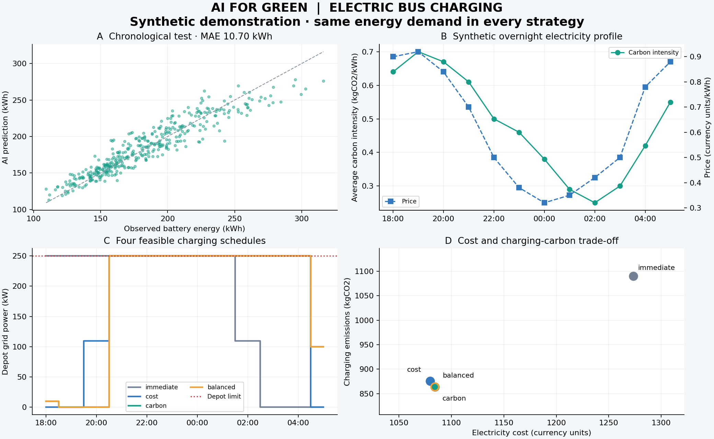

# AI for Green：电动公交低碳充电

一个可以在普通电脑运行的 **机器学习预测 + 约束优化** Python 项目。随机森林预测公交次日运行用电，线性规划安排隔夜充电，比较电费和充电用电相关碳排放。

**数据性质：** 本项目自带数据、电价、碳强度、到场状态均为模拟值，不对应真实城市或公交公司。没有接入生产设备。默认示例展示可复算的方法，不代表现实运营效果。

## 快速开始

```sh
python -m venv .venv
# Windows PowerShell
.venv\Scripts\Activate.ps1
# Linux/macOS 使用 source .venv/bin/activate
python -m pip install -r requirements.txt
python run_demo.py --output results
python -m unittest test_core -v
```

Python 3.10及以上，不需要GPU、不需要API密钥。运行命令时工作目录为本文件所在的 `ai_for_green`。
GitHub演示包将测试文件直接放在本目录；开发版本的测试位于tests目录时使用 `python -m unittest discover -s tests -v`。

核心文件：

| 文件 | 职责 |
| --- | --- |
| `data.py` | 构造可重复模拟数据、校验外部CSV |
| `forecast.py` | 按日期训练/校准/测试随机森林与里程基线 |
| `charging.py` | 四种充电目标、HiGHS求解、独立约束核验 |
| `reporting.py` | CSV/JSON、四面板图、中文报告 |
| `run_demo.py` | 一条命令运行完整流程 |
| `test_core.py`或`tests/test_core.py` | 手算最优解、不可行与守恒等11项测试 |

## 演示结果（固定种子42）

120天×16辆车。按完整日期划分：训练1152行、校准384行、测试384行。
随机森林测试 MAE **10.699 kWh**，里程基线 **30.398 kWh**。
校准残差90%分位余量为13.016 kWh，在测试集上的经验覆盖率为85.94%，没有达到保证90%的承诺。

最后一天的16辆车，在相同2109.67 kWh电网输入条件下：

| 方案 | 电费（货币单位） | 充电 kgCO2 |
| --- | ---: | ---: |
| 尽早充电 | 1273.56 | 1089.92 |
| 最低电费 | 1079.62 | 875.98 |
| 最低碳 | 1084.20 | 863.69 |
| 折中 | 1084.20 | 863.69 |

最低碳方案的模拟充电排放减少20.76%，电费减少14.87%。默认折中权重使其与最低碳方案指标相同。
所有方案的时间窗、单车50 kW、场站250 kW、电池240 kWh和计划充电需求检查通过，最后一天真实模拟用电下没有车辆低于20 kWh储备。
这些结果只来自本模拟场景。时间移位优化本身产生充电排放差异；不能把全部差异归因于AI预测。



仓库根目录中的示例结果CSV/JSON和`REPORT.md`来自上述默认命令；自行运行后相应文件位于指定输出目录。

## 数据接口与可复现

```sh
python run_demo.py --seed 42 --days 120 --buses 16 --output results
python run_demo.py --data fleet_history.csv --output csv_run
python run_demo.py --carbon-price 0.5 --output lower_carbon_weight
```

必需列：`date, bus_id, planned_km, temperature_forecast_c, congestion_forecast, passenger_forecast, hill_index, weekday, lag_energy_kwh, actual_energy_kwh`。

- 每个日期包含同一完整车队；至少30个日期；同一日期/车辆不能重复。
- 用电目标单位kWh；里程km；温度°C；拥堵/坡度指标[0,1]；weekday为周一0至周日6。
- 输入应为**目标运行日**的计划里程、前一日已知的天气/拥堵/客流预测，及前一日已观测用电。外部CSV必须自己确保这些特征在决策时可得。
- `actual_energy_kwh`只用来拟合历史目标与事后评估；不作为测试期的预测特征。
- 不把整段未来真实用电当作一次性多日预测的已知lag。本项目是逐日滚动的一步预测评估。
- 模拟温度使用构造周期以让训练期涵盖温度范围；不考验季节分布漂移。外部数据可能明显降低预测精度，并使计划不可行。
- 外部CSV不会自动获得真实性验证；运行报告标记为`external_csv_unverified`。电网、车辆到场场景仍为模拟。

## 调度数学定义

变量 `p[i,t]` 为车辆i在时间槽t的电网输入功率kW，每槽1小时：

```text
required_i = max(planning_energy_i + reserve - arrival_energy_i, 0)
sum_t(p[i,t] * efficiency * slot_hours) = required_i
0 <= p[i,t] <= 50 when arrival_i <= t < departure_i; else p[i,t] = 0
sum_i p[i,t] <= 250
arrival_energy_i + required_i <= battery_capacity
```

每车独立接入接口、功率连续可调，不能据此推断有限充电枪的整数排班。
`immediate`最小化时间槽序号×电网能量，是受约束的尽早充电LP基线；它不模拟人工排队规则。
`cost`最小化电费；`carbon`最小化平均碳强度加权电网能量；`balanced`最小化电费+碳权重×kgCO2。
碳权重单位为货币单位/kgCO2，是用户设定的偏好，不是已核实的现实碳价。

不可行的容量、充电窗口与场站约束会抛出明确错误，不能静默削减需求。
当前没有电池老化、非线性SOC充电曲线、车辆任务连续性、发车延误、需量电费或边际排放模型。
碳排放边界仅包含平均电网碳强度对应的充电，不包括车辆/电池全生命周期；实际部署需要真实数据与预测期电网信息。

## 输出与检查

`REPORT.md`：中文运行报告；`comparison.png`：预测、碳强度/电价、充电计划、指标对比；
`test_predictions.csv`：逐日期车辆预测；`departure_requirements.csv`：车队状态；
`charging_schedule.csv`：全部方案的逐车逐小时kW；`strategy_metrics.csv`：独立核验指标；
`metrics.json`：实际结果、参数、日期边界、库版本；`input_data/fleet_history.csv`：可重跑输入。

11项测试覆盖确定性数据、按日期隔离、精确手算最优解、效率、不可行问题、容量、非有限输入、能量缺口和真实储备缺口。

## 参考依据

- [NREL：受控充电的价值与权衡](https://www.nrel.gov/news/program/2022/aligning-utilities-electric-vehicles-for-greater-grid.html)
- [scikit-learn：时间序列评估](https://scikit-learn.org/stable/modules/generated/sklearn.model_selection.TimeSeriesSplit.html)
- [SciPy：HiGHS线性规划](https://docs.scipy.org/doc/scipy/reference/optimize.linprog-highs-ipm.html)

参考文献提供背景和工具依据，不验证本模拟场景的百分比。作者可另行决定代码许可；本目录未添加额外开源授权。
